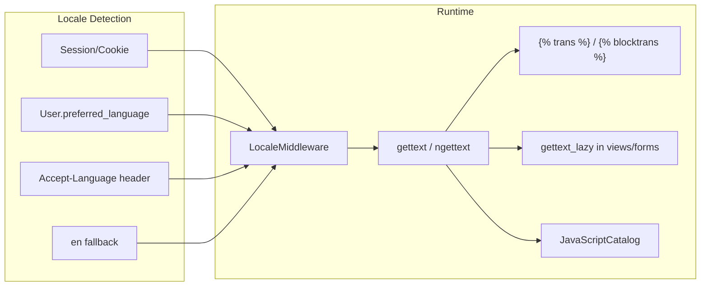

# Multilingual Architecture — FONTESIN

## Overview

Django-standard **gettext** (`.po`/`.mo`) as the single runtime source of truth, with English as mandatory fallback.

**Supported locales:** `en`, `de`, `es`, `fr`  
**Key convention:** `msgctxt` namespacing — logical key `common.save` → `msgctxt "common"` / `msgid "save"`

---

## Locale Detection Flow



### Resolution order

1. Explicit `?lang=` or POST from language switcher → session `django_language`
2. Authenticated `user.preferred_language` (if in `en|de|es|fr`)
3. `Accept-Language` header (first supported match)
4. Fallback: `en`

---

## Settings Configuration

Add to `FontEsin/settings.py`:

```python
from django.utils.translation import gettext_lazy as _

LANGUAGES = [
    ("en", _("English")),
    ("de", _("German")),
    ("es", _("Spanish")),
    ("fr", _("French")),
]
LANGUAGE_CODE = "en"
LOCALE_PATHS = [BASE_DIR / "locale"]
```

Insert `django.middleware.locale.LocaleMiddleware` **after** `SessionMiddleware` (position 3).

---

## File Structure

```
locale/
├── en/LC_MESSAGES/django.po      # source + English
├── de/LC_MESSAGES/django.po
├── es/LC_MESSAGES/django.po
└── fr/LC_MESSAGES/django.po

translations/                      # optional JSON export for translators
├── en/common.json, auth.json, ...
├── de/, es/, fr/
```

### Key convention examples

| Logical key | gettext |
|-------------|---------|
| `common.save` | `msgctxt "common"` / `msgid "save"` |
| `auth.login.title` | `msgctxt "auth.login"` / `msgid "title"` |
| `project.create.success` | `msgctxt "project.create"` / `msgid "success"` |

---

## New Infrastructure Files

| File | Purpose |
|------|---------|
| `FontEsin/middleware/locale.py` | User-preference-aware locale activation |
| `FontEsin/i18n/__init__.py` | Shared helpers, fallback wrapper |
| `FontEsin/templatetags/i18n_extras.py` | ``, `` |
| `locale/en/LC_MESSAGES/django.po` | English catalog (source) |
| `templates/partials/_language_switcher.html` | UI switcher |
| `accounts/management/commands/export_translations_json.py` | JSON export for translators |

### URLs

```python
path("i18n/", include("django.conf.urls.i18n"))  # set_language + JavaScriptCatalog
```

---

## Template Usage

```django


<h1></h1>


  Hello, {{ name }}!

```

Dynamic `html lang`:

```django
<html lang="{{ LANGUAGE_CODE }}">
```

---

## Python Usage

```python
from django.utils.translation import gettext as _
from django.utils.translation import gettext_lazy as _lazy

messages.success(request, _("Company saved successfully."))

class MyForm(forms.Form):
    name = forms.CharField(label=_lazy("Company name"))
```

### Notifications (translate at creation time)

```python
from django.utils import translation

def notify_commission(recipient, ...):
    lang = recipient.preferred_language or "en"
    with translation.override(lang):
        title = _("Commission earned")
        body = _("You earned %(amount)s", amount=amount)
    notify(recipient=recipient, title=title, body=body)
```

---

## JavaScript Bridge

### Toast titles (`main.js`)

Use Django `JavaScriptCatalog`:

```python
# urls.py
path("jsi18n/", JavaScriptCatalog.as_view(), name="javascript-catalog"),
```

```javascript
// After catalog loaded
const TOAST_TITLES = {
  error: gettext("Error"),
  success: gettext("Success"),
  ...
};
```

### ENUMS injection (`users.html`)

Server-side render translated labels into `json_script`:

```django
{{ enums_i18n|json_script:"enums-i18n" }}
<script>
  const ENUMS = JSON.parse(document.getElementById('enums-i18n').textContent);
</script>
```

### Confirm modals

Prefer `` in template attributes or pass translated strings from Django context rather than hardcoded JS literals.

---

## API Localization

- Middleware or DRF hook calls `translation.activate()` from `Accept-Language`
- Wrap all `message` fields with `gettext`
- Optional `Content-Language` response header
- JWT/DRF default errors use activated locale for field labels

---

## Email Localization

Refactor `accounts/utils/mailer.py`:

- Extract to `templates/email/password_reset.html` with ``
- Activate recipient locale before render:

```python
from django.utils import translation

with translation.override(user_language):
    html = render_to_string("email/password_reset.html", context)
```

---

## Dynamic / DB Content

| Content | Strategy |
|---------|----------|
| **CommercialPlan** | Stable gettext keys per plan code (`billing.plan.basic.feature.3`) OR `features_i18n` JSONField keyed by locale |
| **Notifications** | Translate at write-time; store single locale per row (recipient's language) |
| **Industry codes** | Keep English in DB; defer localization |
| **User content** | Never translate |

---

## LanguageChoices Alignment

Split in `accounts/constants.py`:

```python
class SupportedLocale:
    EN, DE, ES, FR = "en", "de", "es", "fr"
    CHOICES = [(EN, "English"), (DE, "German"), (ES, "Spanish"), (FR, "French")]
```

Narrow `User.preferred_language` to `SupportedLocale.CHOICES` (deprecate cs, ar, ja, pt for UI).

---

## Deploy & CI

```bash
python manage.py makemessages -a -l de -l es -l fr
python manage.py compilemessages
```

- Commit `.po` files; `.mo` can be built at deploy
- CI must run `compilemessages` and fail if `.po` has syntax errors
- `msgfmt --statistics locale/de/LC_MESSAGES/django.po` for coverage reports

---

## Adding a 5th Language (Future)

1. Add to `LANGUAGES` in settings
2. `python manage.py makemessages -l xx`
3. Fill `msgstr` entries (or MT + review)
4. `compilemessages`
5. Add option to language switcher partial

Estimated effort: < 1 day engineering + translation time.
