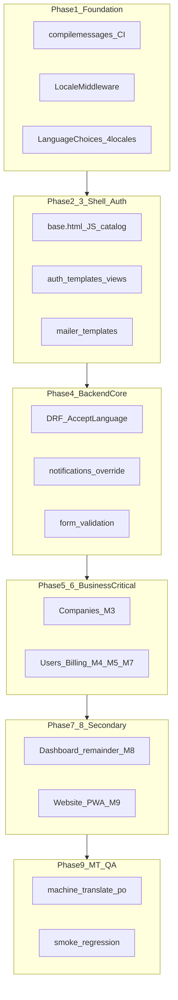
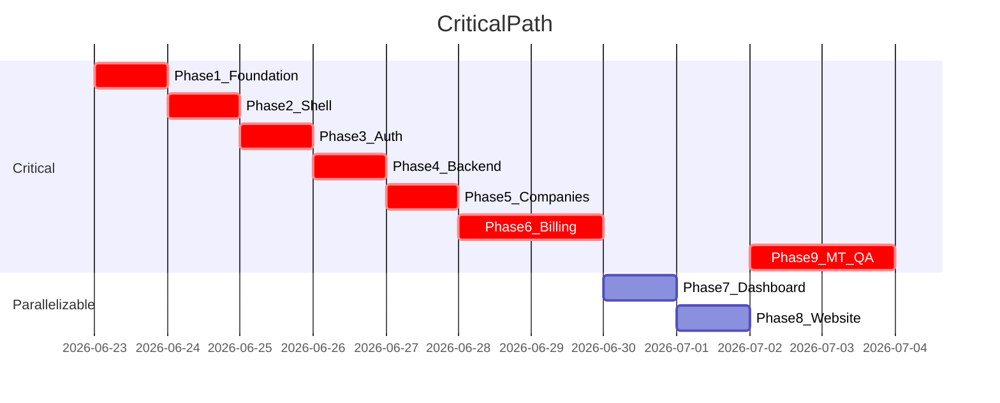

# FONTESIN Multilingual (i18n) — Phased Implementation Plan

**Project memory (load first):** [`.cursor/i18n-project-context.md`](i18n-project-context.md) — single source of truth for completed work, current phase, and do-not-revisit files. **Update after every completed phase.**  
**Primary source:** [`.cursor/multilingual-risk-analysis.md`](multilingual-risk-analysis.md)  
**Supporting docs:** [`.cursor/multilingual-architecture.md`](multilingual-architecture.md), [`.cursor/multilingual-task-list.md`](multilingual-task-list.md)  
**Current state:** See [`.cursor/i18n-project-context.md`](i18n-project-context.md) — Phases 1–4 complete; Phase 5 (Companies) next.

---

# Executive Summary

FONTESIN requires a **gettext-based i18n rollout** across a Django 6 monolith with server-rendered HTML, vanilla JS, and DRF API. The highest-impact risks are: **deploy without `compilemessages`**, **inline JS strings**, **DB plan copy outside `.po`**, **middleware ordering**, and **scope creep across 73 templates / 3000+ strings**.

This plan reorganizes the existing 7–8 day roadmap into **9 testable phases** (~9–10 calendar days including buffer) that:

1. Ship **infrastructure + CI gates first** (blocks Critical operational risk on Day 1).
2. Localize **auth → dashboard core → billing → companies/users** before website/regions.
3. Run **`makemessages` + smoke tests per phase** instead of one end-of-project sweep.
4. Confine each AI session to **one module manifest** (~5–15 files) to cut token use ~70%.
5. Use **machine translation (MT) for bulk `.po` fill** with **human review** reserved for auth, billing, and German formal tone.

**Target locales:** `en` (default + fallback), `de`, `es`, `fr`  
**Explicitly out of scope v1:** cs/ar/ja/pt UI, NACE/NAICS codes, API envelope normalization, regional pages, legacy DB notifications, management command output.

---

# Implementation Strategy



**Guiding principles (from risk matrix):**

| Principle | Risk mitigated |
|-----------|----------------|
| Small PRs per module | Bulk edit regressions, developer review bottleneck |
| `` for HTML | Broken template rendering |
| `JavaScriptCatalog` + `json_script` for JS | Inline JS (`ENUMS`, `appConfirm`, `showToast`) |
| Gettext keys by plan code before billing merge | DB plan copy not in `.po` |
| Map unknown `preferred_language` → `en` | Legacy cs/ar/ja/pt values |
| Wrap strings only; defer API envelope changes | Scope creep |
| English fallback acceptable | Partial localization UX |

---

# Phase 1 — Foundation, CI & Locale Resolution

## Objective

Establish runtime i18n infrastructure and deployment safety nets before any string wrapping.

## Scope

- Django settings: `LANGUAGES`, `LOCALE_PATHS`, `LANGUAGE_CODE = "en"`, i18n context processor
- `LocaleMiddleware` inserted **immediately after `SessionMiddleware`** (position 3)
- Custom `FontEsin/middleware/locale.py`: session + `User.preferred_language` + unknown-locale → `en` fallback
- URL wiring: `path("i18n/", include("django.conf.urls.i18n"))` in `FontEsin/urls.py`
- `templates/partials/_language_switcher.html` + `FontEsin/templatetags/i18n_extras.py`
- Narrow `accounts/constants.py` `LanguageChoices` to 4 supported locales
- Skeleton `locale/en/LC_MESSAGES/django.po` with namespace headers (common, auth, dashboard, billing, notifications, api, email, errors)
- **CI/deploy gate:** `python manage.py compilemessages` must pass on every merge
- Document `msgctxt` naming convention in `.cursor/multilingual-architecture.md`

## Included modules/files

| Area | Files |
|------|-------|
| Settings | `FontEsin/settings.py` |
| Middleware | `FontEsin/middleware/locale.py` (new) |
| URLs | `FontEsin/urls.py` |
| Constants | `accounts/constants.py` — `SupportedLocale` split |
| Locale | `locale/en/LC_MESSAGES/django.po` |
| UI | `templates/partials/_language_switcher.html` |
| CI | New workflow or deploy script (no `.github/` exists today) |

## Dependencies

None — this is the root of the critical path.

## Risks addressed

- Deploy without `compilemessages` (Critical)
- Middleware ordering breaks session/CSRF
- `LanguageChoices` mismatch (8 vs 4)
- `preferred_language` legacy values (cs, ar, ja, pt)
- Inconsistent `msgctxt` naming (document Day 1)
- Stale `.mo` on deploy

## Deliverables

- Working language switcher (session-persisted)
- `translation.activate('de')` verified via test page or shell
- CI fails on invalid `.po` syntax
- Empty `de`/`es`/`fr` locale directories ready for extraction

## Exit criteria

- [ ] Login POST succeeds after middleware insertion (CSRF/session intact)
- [ ] Switching to `de` persists across requests; unknown DB locale maps to `en`
- [ ] `compilemessages` passes locally and in CI
- [ ] `LanguageChoices` UI shows exactly 4 languages

## Effort

**1 day**

---

# Phase 2 — Shared Shell, JS Bridge & Error Pages

## Objective

Convert all shared chrome and establish the JavaScript translation bridge before feature modules.

## Scope

- `templates/base/base.html`: nav, sidebar, confirm modal, dynamic `html lang="{{ LANGUAGE_CODE }}"`
- `templates/base/toasts.html`, `templates/403.html`
- `JavaScriptCatalog` at `jsi18n/` wired in base template
- `static/adminlte/js/main.js`: `TOAST_TITLES` via `gettext()`
- `static/adminlte/js/no_emoji.js`: client toast strings
- Run `makemessages -l de -l es -l fr` for extracted keys from this phase only

## Included modules/files

M1 from task list — 6 template/static files + base URL wiring.

## Dependencies

Phase 1 (LocaleMiddleware, locale dirs, i18n URLs).

## Risks addressed

- Inline JS strings missed (partial — establishes pattern for later grep)
- AI wraps wrong strings in HTML (limited scope — 3 templates)
- Partial localization UX (shared chrome translated first)

## Deliverables

- Dashboard shell renders in 4 locales (labels may still be English in body content)
- Toast titles localized via JS catalog
- First `.po` entries with `msgctxt` namespaces

## Exit criteria

- [ ] Visual smoke: base layout in `en`, `de`, `es`, `fr` — no broken HTML
- [ ] Browser console: `gettext` available; toast fires with localized title
- [ ] `makemessages` produces entries for base templates without syntax errors

## Effort

**0.5–1 day**

---

# Phase 3 — Authentication, Onboarding & Email

## Objective

Complete end-to-end localization of the highest-traffic user path: login through onboarding and password reset email.

## Scope

- All 12 `templates/auth/*` files (~15 inline `showToast`/`appConfirm` strings)
- `accounts/view/auth.py` — ~37 flash/JSON messages
- Refactor `accounts/utils/mailer.py` → `templates/email/password_reset.html` with `` + `translation.override(recipient_lang)`
- Veriff/onboarding templates if they contain user-facing copy
- `makemessages` sweep for auth namespace

## Included modules/files

M2 + partial M12 — auth templates, `auth.py`, `mailer.py`, email templates.

## Dependencies

Phases 1–2 (base layout, JS catalog, locale activation).

## Risks addressed

- High-traffic partial localization
- f-string email bodies lose translation context
- Inline JS in register flow
- MT wrong German formal tone (auth strings flagged for human review in Phase 9)

## Deliverables

- Full auth flow testable in 4 locales
- OTP/password-reset email renders in recipient language
- Auth namespace populated in all 4 `.po` files

## Exit criteria

- [ ] Register → verify → login → forgot password in `de` — no English-only blockers on auth pages
- [ ] Email received with German subject/body when `preferred_language=de`
- [ ] Grep `templates/auth/` for unwrapped string literals returns zero user-facing hits

## Effort

**1 day**

---

# Phase 4 — Backend Cross-Cutting: API, Notifications, Forms & Constants

## Objective

Localize all Python-side messages that span multiple dashboard modules before module-specific template work.

## Scope

- Wrap `messages.*` and `JsonResponse` `"message":` strings across 16 view files (grep-driven list in `.cursor/multilingual-task-list.md` Day 3)
- `accounts/forms/company_form.py` (~39 ValidationErrors), `tenant_form.py`
- `accounts/utils/notifications.py` — `translation.override(recipient_lang)` at notify-time
- DRF `Accept-Language` activation hook + `accounts_api/view/companies.py`, `profile.py`, serializers
- `accounts/constants.py` choice labels via `gettext_lazy`
- `FontEsin/middleware/no_emoji.py`, `billing/utils.py` plan-gate API errors
- **Do not** normalize API response envelopes (explicitly deferred per risk matrix)

## Included modules/files

M6, M10, M11, M13 — 16+ view files, 2 form files, notifications, API, middleware.

## Dependencies

Phase 1 (locale activation); Phase 3 patterns for `_()` usage.

## Risks addressed

- Under-translating API errors
- Interpolation in notifications (f-strings)
- Over-translating admin-only strings (skip management commands, ADRs, logs)
- Inconsistent API envelopes (wrap strings only)

## Deliverables

- API returns localized `message` with `Accept-Language: de`
- New notifications stored in recipient locale
- Form validation errors translatable

## Exit criteria

- [ ] `curl -H "Accept-Language: de"` on a gated API endpoint returns German message
- [ ] Trigger test notification for `de` user — title/body in German
- [ ] Grep `"message": "` in `accounts_api/` and `accounts/view/` — all wrapped
- [ ] `django check` passes

## Effort

**1 day**

---

# Phase 5 — Companies Module (Business-Critical)

## Objective

Localize the largest dashboard surface: company CRUD, import, and related API.

## Scope

- `templates/dashboard/companies.html` (~2096 lines) + partials (`_company_*`, pagination, rows)
- `accounts/view/company.py`, `company_import.py`
- Remaining `accounts_api/view/companies.py` template-adjacent strings
- Inline `showToast` / `appConfirm` in company templates
- CSV import error labels
- `makemessages` for companies namespace

## Included modules/files

M3 — ~8 templates, 2 view files, API serializer messages.

## Dependencies

Phase 4 (form validation, API patterns already wrapped).

## Risks addressed

- Scope creep across 73 templates (isolated to companies only)
- AI splits HTML tags in large template (visual QA required)
- `blocktrans` variable mismatches in dynamic company rows

## Deliverables

- Company CRUD + CSV import fully wrapped
- Companies namespace in `.po` files

## Exit criteria

- [ ] Create/edit/delete company in `de` — UI labels, modals, toasts localized
- [ ] CSV import error toasts in correct locale
- [ ] Visual smoke: company list pagination and modals — no layout breaks
- [ ] **Contingency trigger:** if incomplete, defer website (Phase 8) per risk doc

## Effort

**1–1.5 days**

---

# Phase 6 — Users, Billing & Workflow Features

## Objective

Localize RBAC, subscription/billing UI, and join/partnership workflows — including high-risk DB plan copy.

## Scope

### M4 — Users & Roles
- `templates/dashboard/users.html` + `ENUMS` via `json_script` injection
- `_users_panel.html`, roles/permissions/assign_roles templates
- `accounts/view/user.py` (~68 JsonResponse messages)

### M5 — Billing (high risk)
- Billing templates: plans, subscriptions, payments, commissions, invoices, plan_history
- `billing/views.py` + XLSX export column headers
- **`CommercialPlan` i18n:** stable gettext keys by plan code (`billing.plan.{code}.feature.{n}`) **before PR merge**
- `templates/website/membership.html`, `invoice.html`

### M7 — Workflows
- join_requests, partnerships, coordinator_requests, applications templates + views

## Included modules/files

M4, M5, M7 — ~20 templates, `user.py`, `billing/views.py`, join/partnership/coordinator views.

## Dependencies

Phase 4 (billing/utils.py API errors); Phase 5 (company patterns for large templates).

## Risks addressed

- DB plan copy not in `.po` (Critical for billing UX)
- Inline JS `ENUMS` injection
- German formal tone in billing (flag for human review)
- Companies module slip contingency: this phase can absorb +0.5 day from Phase 8

## Deliverables

- User management modals + ENUMS dropdowns in 4 locales
- Plan cards show localized features (not English DB copy beside German UI)
- Billing admin + XLSX headers localized

## Exit criteria

- [ ] Assign role / invite user flow in `de`
- [ ] Plan comparison page: all feature bullets match UI locale
- [ ] Join request approve/deny messages localized
- [ ] Spot-check 10 billing strings for German formal tone (document issues for Phase 9)

## Effort

**1.5–2 days**

---

# Phase 7 — Profile, Dashboard Remainder & Secondary Features

## Objective

Complete remaining authenticated dashboard surfaces before public marketing pages.

## Scope

- M8: `templates/profile/*`, `profile.py`, saved_filter, certification views
- Dashboard remainder: index, search, messages, contact_messages, certifications, saved_filters, audit_logs, consultant_statistics, tenants
- Convert all remaining `appConfirm()` inline strings in partials
- `makemessages` sweep for dashboard/profile namespaces

## Included modules/files

M8 + ~15 dashboard templates from task list Day 6 "Dashboard remainder".

## Dependencies

Phases 2–6 (shared patterns established).

## Risks addressed

- Scope creep (website still excluded)
- Missed inline confirm modals (grep `appConfirm(` at phase end)

## Deliverables

- All authenticated dashboard pages wrapped
- Profile and settings localized

## Exit criteria

- [ ] Profile edit + plan card in `de`
- [ ] Grep `appConfirm(` across `templates/dashboard/` — zero hardcoded English user strings
- [ ] Audit logs / consultant stats render without template errors in `fr`

## Effort

**1 day**

---

# Phase 8 — Website, PWA & Final Extraction Sweep

## Objective

Localize public marketing surfaces and PWA metadata; run final `makemessages -a` gap fill.

## Scope

- `templates/website/*` — 9 files (exclude `templates/regions/*` — out of scope v1)
- `accounts/view/website.py`
- `static/manifest.json`, `static/adminlte/js/sw.js`
- Final `makemessages -a -l de -l es -l fr`
- Grep sweep: `showToast(`, `appConfirm(`, `alert(`, `"message": "`

## Included modules/files

M9 + M12 remainder.

## Dependencies

All prior phases; **deferrable** if Phase 5/6 overrun (per contingency plan).

## Risks addressed

- Scope creep 73 templates / 3000+ strings (website last)
- AI misses inline JS strings (final grep gate)
- Under-translating before QA phase

## Deliverables

- Public website pages wrapped (regions stay English)
- PWA manifest localized
- Complete `.po` catalogs with all msgids extracted

## Exit criteria

- [ ] Homepage + contact page in `de`
- [ ] Grep hardcoded string patterns — zero unwrapped user-facing hits in scope
- [ ] `msgfmt --statistics` baseline captured per locale

## Effort

**1 day** (deferrable to Week 2 if behind schedule)

---

# Phase 9 — Machine Translation, QA, Buffer & Rollout

## Objective

Fill translations, validate quality, fix regressions, and deploy to staging with documented human-review backlog.

## Scope

- MT-fill empty `msgstr` in `de`/`es`/`fr` `.po` files (batch by namespace, not whole file)
- `compilemessages` + `msgfmt --check` + interpolation audit
- Manual smoke tests: auth, companies, users, billing, API (all 4 locales)
- Fix `blocktrans` variable mismatches
- Performance check: compiled `.mo` only, no per-request JSON reads
- Update translator workflow docs; release checklist + rollback plan
- Schedule Week 2+ human `de` review (3–5 days post-launch)

## Included modules/files

All `locale/*/LC_MESSAGES/django.po`, CI pipeline, `docs/` translator workflow.

## Dependencies

Phases 1–8 complete (or Phase 8 deferred with EN fallback on website).

## Risks addressed

- AI wraps wrong strings (visual QA Day 7 equivalent)
- `blocktrans` variable mismatches
- MT wrong German formal tone
- CI `compilemessages` fails
- >20% broken pages contingency → extend buffer, defer website

## Deliverables

- >80% non-empty `msgstr` per locale
- Staging deployment
- Human QA backlog for strategic `de` strings
- Coverage report (`msgfmt --statistics`)

## Exit criteria

- [ ] Zero broken pages in smoke test matrix
- [ ] >80% translation coverage; EN fallback for gaps
- [ ] CI green on `compilemessages`
- [ ] Rollback documented; Week 2 review scheduled

## Effort

**1–2 days** (includes Day 8 buffer from original plan)

---

# Critical Path Analysis



## Critical path items (must complete in order)

1. **Phase 1** — CI `compilemessages` gate + `LocaleMiddleware` position
2. **Phase 2** — `JavaScriptCatalog` (blocks all inline JS phases)
3. **Phase 3** — Auth (validates end-to-end locale flow)
4. **Phase 4** — Notifications + API (blocks correct cross-module behavior)
5. **Phase 5** — Companies (largest business-critical UI)
6. **Phase 6** — Billing + `CommercialPlan` gettext keys (product risk)
7. **Phase 9** — MT fill + smoke regression (ship gate)

## Parallelizable work

| Can run in parallel | Condition |
|---------------------|-----------|
| Phase 7 (dashboard remainder) partial templates | After Phase 4 patterns documented; independent templates |
| Phase 8 (website) vs late Phase 7 items | Different developers/AI sessions; no shared files |
| MT fill by namespace (`auth`, `billing`, etc.) | After Phase 9 starts; independent `.po` sections |
| Week 2 human `de` review | Post-launch; parallel with `es`/`fr` pilot QA |

## Manual QA required

| Area | Why |
|------|-----|
| All converted templates with HTML | AI may split tags; visual smoke every phase |
| Auth + billing flows in `de` | Formal tone, legal/commercial copy |
| Dynamic pages (company rows, user ENUMS) | `blocktrans` variable mismatches |
| Email rendering | HTML + interpolation |
| Login POST after middleware change | CSRF/session regression |
| Plan comparison cards | DB copy vs gettext key alignment |

## Machine translation suitable

| Area | Rationale |
|------|-----------|
| Bulk dashboard labels (buttons, headers, table columns) | Low nuance; EN fallback acceptable |
| Form field labels | Standard UI vocabulary |
| Toast/info messages (non-legal) | High volume, low risk |
| `es`/`fr` full catalogs | Pilot markets; review in Week 2 |
| Website marketing body copy | Medium risk; human spot-check top pages |

## Human translation review required

| Area | Rationale |
|------|-----------|
| Auth flows (`de`) | Formal address (Sie), trust/security copy |
| Billing/plan features (`de`) | Commercial accuracy, pricing terms |
| Error messages with legal implications | Compliance tone |
| Email subjects | Deliverability + tone |
| Notification titles with amounts/names | Interpolation correctness |
| ~50 strategic `de` strings | Risk matrix spot-check requirement |

---

# PR Breakdown

| PR | Name | Scope | Expected size | Review considerations |
|----|------|-------|---------------|----------------------|
| **PR-1** | `i18n/phase-1-infrastructure` | Settings, middleware, switcher, locale skeleton, CI gate, LanguageChoices | ~300–500 LOC, 8–12 files | **Block merge if `compilemessages` fails.** Verify middleware order. Test login POST. |
| **PR-2** | `i18n/phase-2-shared-shell-js` | base.html, toasts, 403, main.js, no_emoji.js, JavaScriptCatalog | ~400–600 LOC, 6–8 files | Visual layout check. Confirm `gettext` loads in browser. |
| **PR-3** | `i18n/phase-3-auth-email` | 12 auth templates, auth.py, mailer refactor, email templates | ~800–1200 LOC, 15–18 files | End-to-end auth test. Email preview in `de`. Grep auth toasts. |
| **PR-4** | `i18n/phase-4-backend-api-notifications` | 16 views, forms, notifications, API, constants, middleware errors | ~600–900 LOC, 20+ files | API `Accept-Language` test. Notification locale test. No envelope changes. |
| **PR-5** | `i18n/phase-5-companies` | companies.html + partials, company views, import | ~1500–2500 LOC, 10–12 files | **Largest PR** — split if >2500 LOC. Visual QA modals/pagination. |
| **PR-6** | `i18n/phase-6-users-billing-workflows` | users, billing templates, CommercialPlan keys, join/partnership | ~2000–3000 LOC, 20+ files | **Split billing into PR-6a/6b if needed.** Plan card locale alignment mandatory before merge. |
| **PR-7** | `i18n/phase-7-dashboard-profile` | Profile + remaining dashboard templates | ~1000–1500 LOC, 15–18 files | Grep `appConfirm`. Secondary priority — can merge after PR-6. |
| **PR-8** | `i18n/phase-8-website-pwa-sweep` | Website templates, manifest, sw.js, final makemessages | ~600–1000 LOC, 12–15 files | Deferrable. Regions excluded. Final grep gate. |
| **PR-9** | `i18n/phase-9-translations-qa` | MT-filled `.po` files, fixes, docs, CI hardening | ~3000+ lines `.po`, few code fixes | Review `.po` syntax not content. Spot-check critical `de` strings. Statistics report attached. |

**PR rules:** Max ~2500 LOC per PR where possible; always run `django check` + `compilemessages` before review; attach phase exit-criteria checklist to PR description.

---

# Drift Prevention Framework

## Definition of done (per phase)

| Phase | Done when |
|-------|-----------|
| 1 | Switcher works; locale persists; CI gate live; 4 locales only |
| 2 | Shared chrome + JS toasts translated; no HTML breaks |
| 3 | Full auth + OTP email in user locale |
| 4 | API + notifications + forms return localized strings |
| 5 | Company CRUD/import/API localized |
| 6 | Users + billing plan cards + workflows localized |
| 7 | Profile + dashboard remainder wrapped |
| 8 | Website + PWA wrapped; final grep clean |
| 9 | >80% coverage; staging deployed; human backlog documented |

## Validation checkpoints

- **After every PR:** `python manage.py check` + `compilemessages`
- **After template PRs:** visual smoke in `en` + one non-English locale (`de`)
- **After Phase 4:** API curl test with `Accept-Language`
- **After Phase 6:** plan card locale alignment audit
- **Phase 9:** full 4-locale smoke matrix (auth, companies, users, billing, API)

## Translation coverage checkpoints

| When | Command / action | Target |
|------|------------------|--------|
| End of Phase 2 | `msgfmt --statistics locale/de/LC_MESSAGES/django.po` | Baseline ~5% |
| End of Phase 6 | Same | ~60–70% msgids extracted |
| End of Phase 8 | `makemessages -a` + statistics | ~95% msgids extracted |
| Phase 9 | MT fill + statistics | >80% non-empty `msgstr` |

## Regression checkpoints

- Login/logout POST (CSRF) after Phase 1
- Company create with validation errors after Phase 5
- Role assignment JSON responses after Phase 6
- Billing XLSX export opens correctly after Phase 6
- No new hardcoded strings: grep patterns at each phase boundary

## Documentation requirements

- Update `.cursor/multilingual-architecture.md` if conventions change
- Add `docs/i18n-translator-workflow.md`: `makemessages`, MT fill, human review process
- PR template section: phase exit criteria checklist
- Week 2 backlog doc: flagged `de` strings from billing/auth

## Acceptance criteria (project v1)

- Language switcher on dashboard and website
- Session + `preferred_language` drive locale; unknown → `en`
- Auth, companies, users, billing, notifications, API covered
- `de`/`es`/`fr` `.po` populated (MT acceptable; EN fallback for gaps)
- `compilemessages` in CI
- No broken template rendering
- Human `de` review backlog documented

---

# Translation QA Strategy

## Incremental validation (per phase)

1. **Extract:** `makemessages` for touched apps only
2. **MT-fill (optional early):** fill new keys in target phase namespace for immediate visual test
3. **Compile:** `compilemessages`
4. **Smoke:** 2-locale spot check (`en` + `de`)
5. **Grep gate:** phase-specific patterns before PR merge

## Phase 9 full QA matrix

| Flow | Locales | Type |
|------|---------|------|
| Register/login/reset | en, de, es, fr | Manual |
| Company CRUD + import | en, de | Manual |
| User invite + roles | en, de | Manual |
| Billing/plan view | de only | Manual + human review |
| API plan gate | de (header) | Automated curl |
| Dynamic row rendering | de | Manual (blocktrans) |
| Email OTP | de | Manual |

## Quality tiers

- **Tier A (human review):** auth, billing, emails, notifications — before staging
- **Tier B (MT + spot-check):** dashboard labels, website copy
- **Tier C (MT only, EN fallback OK):** audit logs, consultant stats, secondary labels

## Contingency triggers (from risk doc)

| Scenario | Action |
|----------|--------|
| >20% broken pages in Phase 9 | Extend buffer 1 day; defer Phase 8 to Week 2 |
| `de` MT quality unacceptable | Ship with EN fallback for `de`; prioritize human review |
| Companies not done by Phase 5 deadline | Move billing start +1 day; defer website |
| CI `compilemessages` fails | Block merge; fix `.po` syntax |

---

# Token Optimization Strategy

## Limit AI context size

- **One module manifest per session** — load only the 5–15 files listed in that phase's "Included modules/files"
- **Pre-load convention doc once:** `.cursor/multilingual-architecture.md` `msgctxt` rules (~100 lines), not the full codebase
- **Never attach `companies.html` + `users.html` in the same session** — largest files (~3400 lines combined)
- **Use risk doc as guardrails** — `.cursor/multilingual-risk-analysis.md` "Out of Scope" section prevents scope debates

## Process modules independently

```
Session workflow:
1. Read phase manifest (file list from task list)
2. Read 1–2 exemplar files already converted (e.g., login.html after Phase 3)
3. Convert manifest files using same pattern
4. Run phase grep gate (not full-repo scan)
5. makemessages for touched apps only
6. Commit / open PR
```

## Avoid repeatedly scanning the entire codebase

| Instead of | Use |
|------------|-----|
| Full-repo semantic search each session | Phase-specific grep patterns from task list |
| Re-reading all 73 templates | Module index M0–M13 file lists in `.cursor/multilingual-task-list.md` |
| Whole-repo `makemessages` every commit | `makemessages -l de --ignore=venv` after each phase; full `-a` only in Phase 8 |
| Re-explaining architecture | Point AI to `.cursor/multilingual-architecture.md` + completed PR diff as exemplar |

## Recommended workflow for translation keys and `.po` files

1. **Wrap in source** using `msgctxt` convention (``, `_('Company saved.')`)
2. **Extract per phase:**
   ```bash
   python manage.py makemessages -l de -l es -l fr --ignore=venv
   ```
3. **MT-fill by namespace** (not entire `.po` at once):
   - Export slice: grep `#: accounts/view/auth.py` sections or use `msgattrib --sort-by-file`
   - MT only empty `msgstr ""` entries in that slice
   - Preserve `%(variable)s` and `{}` placeholders exactly
4. **Validate:**
   ```bash
   msgfmt --check locale/de/LC_MESSAGES/django.po
   python manage.py compilemessages
   ```
5. **Human review Tier A strings** before merging Phase 9 PR

**Estimated token savings:** ~60–70% vs. whole-codebase sessions by scoping to module manifests and grep gates.

---

# Final Recommended Timeline

| Phase | Days | Cumulative | PR |
|-------|------|------------|-----|
| 1 — Foundation & CI | 1 | Day 1 | PR-1 |
| 2 — Shared Shell & JS | 0.5–1 | Day 2 | PR-2 |
| 3 — Auth & Email | 1 | Day 3 | PR-3 |
| 4 — Backend/API/Notifications | 1 | Day 4 | PR-4 |
| 5 — Companies | 1–1.5 | Day 5–6 | PR-5 |
| 6 — Users/Billing/Workflows | 1.5–2 | Day 6–8 | PR-6 |
| 7 — Dashboard Remainder | 1 | Day 8–9 | PR-7 |
| 8 — Website & PWA | 1 | Day 9–10 | PR-8 (deferrable) |
| 9 — MT, QA & Rollout | 1–2 | Day 10–12 | PR-9 |

**Total: 9–12 calendar days** (8 core + 1–4 buffer/deferral)

**Week 2+ (post-launch, not blocking v1):**
- Human `de` translation review — 3–5 days
- `es`/`fr` pilot QA — 2 days
- Deferred website/regions if contingency triggered
- API envelope normalization — separate ticket (out of scope)

---

## Key files to create (Phase 1)

- `FontEsin/middleware/locale.py`
- `FontEsin/templatetags/i18n_extras.py`
- `templates/partials/_language_switcher.html`
- `locale/{en,de,es,fr}/LC_MESSAGES/django.po`
- CI step for `compilemessages`
